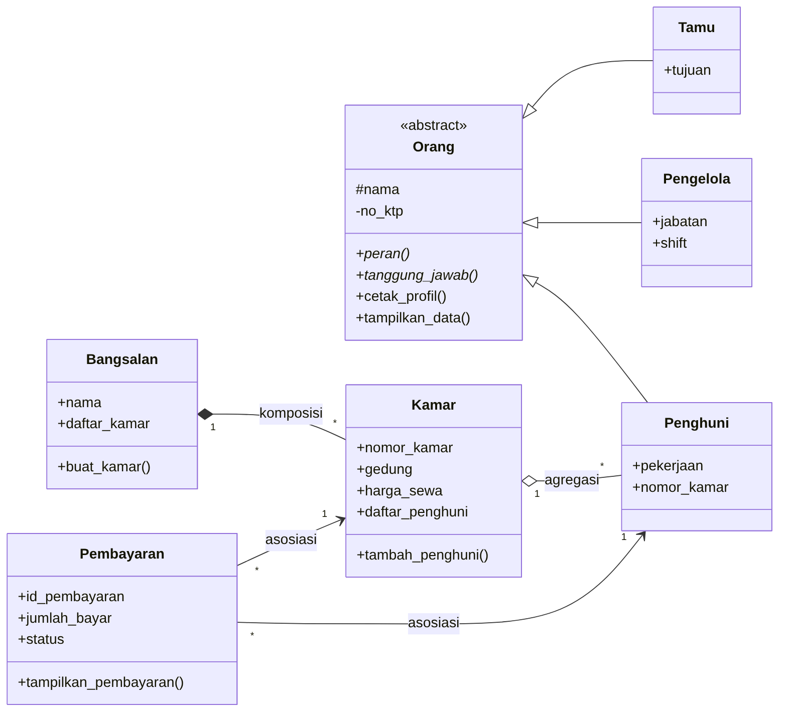
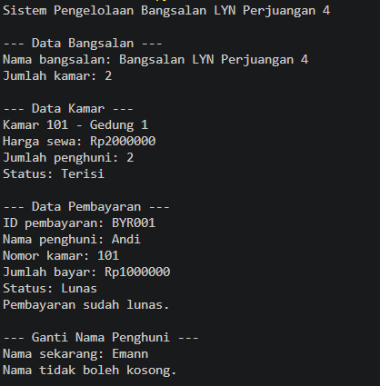
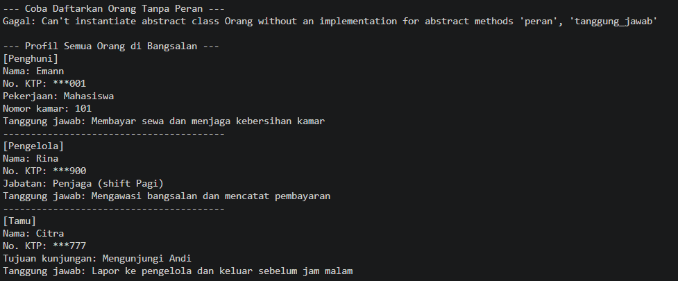
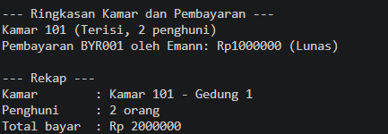

# Sistem Pengelolaan Bangsalan LYN Perjuangan 4

**Posttest PBO: Polimorfisme dan Abstraksi**

- Nama: Muhammad Ali Fathan Ramadhan
- NIM: 2509106026
- Kelas: A'25

## Deskripsi Program

Program ini mengelola sebuah bangsalan (kos) yang terdiri dari beberapa kamar. Setiap kamar bisa dihuni lebih dari satu penghuni, dan setiap pembayaran sewa dicatat untuk penghuni dan kamar tertentu. Selain penghuni, ada juga pengelola yang menjaga bangsalan dan tamu yang berkunjung. Program ini melanjutkan posttest sebelumnya (inheritance) dengan menambahkan abstraksi dan polimorfisme.

File program:`2509106026_Muhammad Ali Fathan Ramadhan_Pt3PBO.py`

## Class Diagram

### Penjelasan Relasi

- **Asosiasi: `Pembayaran` → `Penghuni` dan `Pembayaran` → `Kamar`.** Objek `Pembayaran` hanya menyimpan referensi ke penghuni dan kamar (`self.penghuni`, `self.kamar`) untuk mencatat siapa membayar kamar yang mana. Keduanya tetap ada walaupun data pembayarannya dihapus.
- **Agregasi: `Kamar` ◇— `Penghuni`.** `Kamar` menyimpan daftar penghuni (`daftar_penghuni`) lewat `tambah_penghuni()`, tetapi objek `Penghuni` dibuat di luar kamar. Kalau kamarnya dihapus, penghuni tetap ada sebagai objek sendiri, jadi ini agregasi, bukan komposisi.
- **Komposisi: `Bangsalan` ◆— `Kamar`.** Objek `Kamar` dibuat langsung di dalam `Bangsalan.buat_kamar()`, bukan dari luar. Kamar tidak punya arti tanpa bangsalannya, jadi kalau bangsalan dihapus, kamar-kamarnya ikut hilang.

## Abstraksi

- **Abstract class:** `Orang` (mewarisi `ABC`) dengan dua `@abstractmethod`, yaitu `peran()` dan `tanggung_jawab()`.
- **Subclass:** `Penghuni`, `Pengelola`, dan `Tamu`, ketiganya mengimplementasikan kedua abstract method tersebut.
- **Method konkret:** `cetak_profil()` di `Orang`, dipakai bersama oleh semua subclass. Method ini memanggil `peran()`, `tampilkan_data()`, dan `tanggung_jawab()`.
- **Inheritance tetap dipakai:** setiap subclass memanggil `super().__init__(...)`, punya atribut sendiri (`pekerjaan`, `jabatan`, `tujuan`, dan lainnya), dan atribut `_nama` (protected) serta `__no_ktp` (private) di `Orang`.
- **Bukti tidak bisa diinstansiasi:** `Orang("Test", "KTP000")` dibungkus `try-except TypeError`, hasilnya ada di screenshot output.

## Polimorfisme

- **Lewat pewarisan:** method `tampilkan_data()` di-override oleh `Penghuni`, `Pengelola`, dan `Tamu` dengan isi yang berbeda. Ketiganya dipanggil lewat satu loop `for orang in [penghuni1, pengelola1, tamu1]`.
- **Duck typing:** kelas `Kamar` dan `Pembayaran` tidak berhubungan lewat pewarisan, tetapi sama-sama punya method `ringkasan()`. Keduanya dipanggil lewat fungsi yang sama, `cetak_ringkasan()`.
- **Operator overloading:** `Kamar.__str__()` dan `Kamar.__len__()` (jumlah penghuni), serta `Pembayaran.__add__()` dan `__radd__()` untuk menjumlahkan pembayaran.
- Tidak ada rantai `if/elif` yang mengecek `type()` atau jenis objek. Perilaku tiap objek ditentukan oleh method miliknya sendiri.

## Screenshot Output

**Data bangsalan, kamar, pembayaran, dan setter**

**Bukti abstract class tidak bisa diinstansiasi dan polimorfisme lewat pewarisan**

**Duck typing dan operator overloading**

## Penerapan SOLID (Nilai Plus)

**Open/Closed Principle (OCP).** Kelas `Tamu` ditambahkan sebagai subclass baru dari `Orang` tanpa mengubah kelas lain maupun loop yang menampilkan profil. Loop tersebut tetap berjalan untuk `Tamu` karena hanya bergantung pada method yang ada di `Orang`, sehingga jenis orang baru bisa ditambah tanpa mengubah kode lama.
